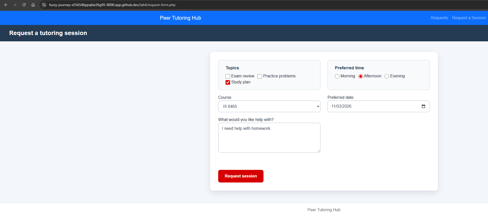

Part 1 

Describe what happens after you submit the form. 
The request form then submits a post request to process-request.php and the process-request page validates the values submitted. If there are no errors then the process-request displays the confirmation, if there are 
errors then it will display the errors. 

Part 2

1. it provides the stylesheet and the peer tutoring hub header. 
2. The nav.php provides a navigation header at the top right of the screen. Allowing for easier navigation through pages.
3. The footer template provides the peer tutoring hub footer and the Bootstrap js file. 
4. require_once is appropriate for these files because they are integral to the webpage. It is important for these pages to load and if they don't then it will throw an error. Typically if you want to the files to be included multiple times without causing issues then require_once is preferred.
5. In the header.php page template

Part 3

1. reason - This textarea control is there to allow to submit whatever input they require. PHP will receive a string value. 
2. topics[] - The purpose of the checkbox control is to allow you to select multiple topics. The value that PHP receives is an array of the different selections. 
3. preferredtime - The radio control is there so you are only able to select one time from the multiple options available. The value received is the string associated with the option selected from the approved array. 
4. preferreddate - The date control is used to ensure that the input is in the form of a valid date. The value PHP receives is the date that was input from the user. 
5. form_name - The purpose of this hidden control is to ensure the user cant see or edit the value received. PHP receives the string "tutoring_request" and makes sure it matches that value. 

Part 4

Test 1:
1. "Exam Review", "Morning", "IS 6465", "11/02/2026", "I need help filling out this form."
2. Accepted
3. Request received
Course: IS 6465
Request details: I need help filling out this form.
Topics: Exam review
Status: Pending review
4. Request eligibility

Test 2: 
1. "Exam Review", "Morning", "IS 6465", "11/02/2026", "hi"
2. Rejected
3. Request could not be submitted
Describe your request using 10 to 500 characters.
4. Form validation

Test 3: 
1. "Exam Review", "Morning", "IS 6465", "10/01/2026", "I need help filling out this form."
2. Rejected
3. Request could not be submitted
Preferred date cannot be in the past.
4. input validation

Part 5:

1. Results from validation-tests.php 
Valid time: PASS

Missing time: PASS

Altered value: PASS

Multiple valid topics: PASS

Missing topics: PASS

Altered topic: PASS

Minimum length: PASS

Maximum length: PASS

Too short: PASS

Too long: PASS

2. Identify the page that represents each CRUD action. 

CRUD action	                Page
Create	                    request-form.php
Read one request	        request-details.php
Read all requests	        requests.php
Update	                    edit-request.php
Delete	                    delete-request.php

Part 5 Answers:
1. request_id
2. Because it allows you to display the certain request associated with the request_id and it is only retrieving information. 
3. Because the POST requests are changing the server data and it allows for better validation processes. GET requests could potentially cause an unintended change. 
