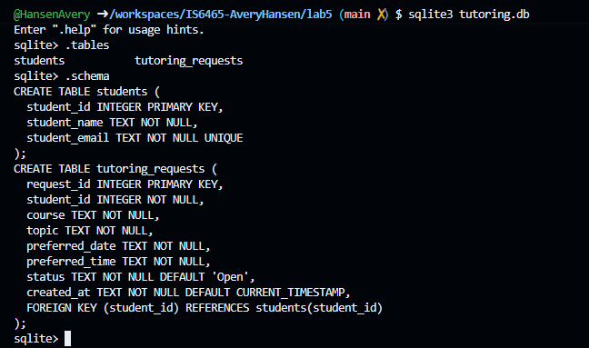
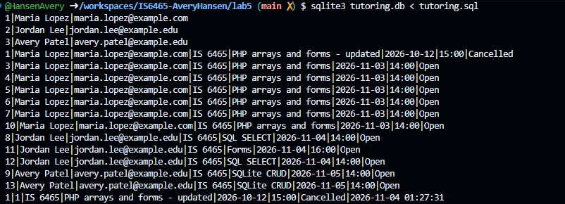
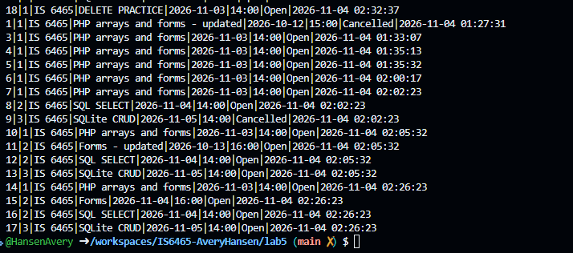

Part 1:
1. 
2. student_id in the students table, and request_id in the tutoring_requests table. 
3. The student_id column in tutoring_requests is the foreign key and it represents a relationship between the tutoring_requests table and the students table. The foreign key in the tutoring_requests table references the id/primary key from the students table
to represent where the id is coming from. 
4. the student_email is marked unique because no student should have the same email, because emails are unique. 

Part 2:
1.INSERT OR ignore INTO students (student_name, student_email)
VALUES ('Jordan Lee', 'jordan.lee@example.edu');

INSERT OR ignore INTO students (student_name, student_email)
VALUES ('Avery Patel', 'avery.patel@example.edu');

INSERT OR ignore INTO tutoring_requests
  (student_id, course, topic, preferred_date, preferred_time)
VALUES
  (2, 'IS 6465', 'Forms', '2026-11-04', '16:00'); 

INSERT OR ignore INTO tutoring_requests
  (student_id, course, topic, preferred_date, preferred_time)
VALUES
  (2, 'IS 6465', 'SQL SELECT', '2026-11-04', '14:00'); 

INSERT OR ignore INTO tutoring_requests
  (student_id, course, topic, preferred_date, preferred_time)
VALUES
  (3, 'IS 6465', 'SQLite CRUD', '2026-11-05', '14:00');

2. 
3. Jordan has one student row because there is only one of him, but there are two request rows because one student can make multiple requests. In this case, the student ID 2 was associated with him and there are two seperate requests with the FK 2. 
This is a one to many relationship. 

Part 3:
1. The JOIN clause is used to combine rows from two or more tables, based on a related column between them. It connnects two tables. 
2. JOIN is to combine multiple tables and WHERE is used to filter the results based on a set of criteria. 
3. The application will only retrieve one request by the id because that is the PK and for each request it is assigned a new request_id. No two rows are going to have the same request_id. 

Part 4:
1. UPDATE tutoring_requests
SET topic = 'Forms - updated',
    preferred_date = '2026-10-13',
    preferred_time = '16:00'
WHERE request_id = 11;

UPDATE tutoring_requests
SET status = 'Cancelled'
WHERE request_id = 9;

2. 
9|3|IS 6465|SQLite CRUD|2026-11-05|14:00|Cancelled|2026-11-04 02:02:23
10|1|IS 6465|PHP arrays and forms|2026-11-03|14:00|Open|2026-11-04 02:05:32
11|2|IS 6465|Forms - updated|2026-10-13|16:00|Open|2026-11-04 02:05:32

3. 9|3|IS 6465|SQLite CRUD|2026-11-05|14:00|Cancelled|2026-11-04 02:02:23
4. The WHERE clause is important in an update statement because it defines what row is being updated. Without the WHERE clause it will update the whole table. 
5. It is better to use a cancelled status so the requests are still available and they aren't just removed from the system. There may be a situation where you would want to see cancelled requests, and if you delete them it wouldn't be possible. 

Part 5:
1.INSERT OR ignore INTO tutoring_requests
  (student_id, course, topic, preferred_date, preferred_time)
VALUES
  (1, 'IS 6465', 'DELETE PRACTICE', '2026-11-03', '14:00');

2.DELETE from tutoring_requests
WHERE request_id = 18;

3. 
4. The WHERE clause is important because it defines the record you want removed, without specifying the record it would delete the whole table. 

Part 6: 
1. The database preserves the connection between a student and their requests by utilizing the foreign key which connects the request table to the students table primary key. 
2. unique text
3. it could nullify the whole table/database
4. So you can prevent SQL injections, it allows for validation and improves reusability capabilities. 