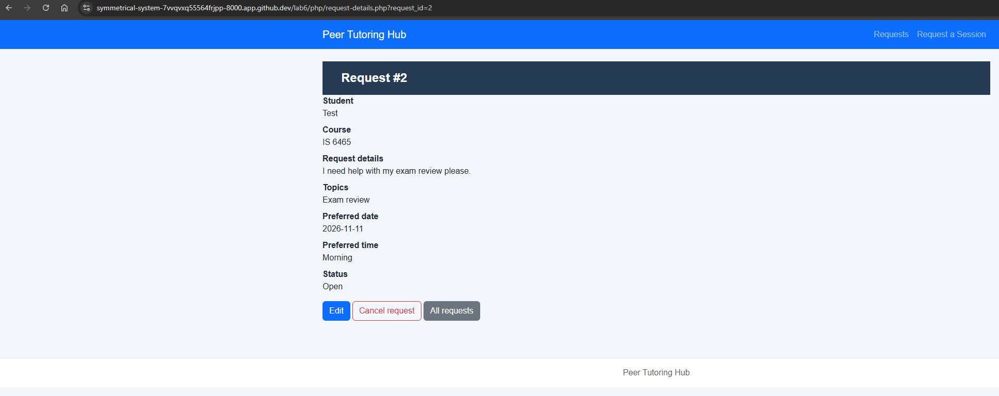

Part 1:
@HansenAvery ➜ /workspaces/IS6465-AveryHansen/lab6 (main ✗) $ sqlite3 database/tutoring.db
SQLite version 3.34.1 2021-01-20 14:10:07
Enter ".help" for usage hints.
sqlite> .tables
students           tutoring_requests

Part 2:
1. Index.php
2. Request #2 was submitted and the status displayed open. SELECT * FROM tutoring_requests;
3. 

Part 3:

Test	                            What I Did	                                    Expected Result	                                        Actual Result	                                    Pass or Fail
Submit a valid request              I filled out the form with valid parameters     A new tutoring request is created with status open      A new tutoring request is created with status open  PASS
View all requests                   I selected all requests from the details page   The new request appears in the request list             The new request appears in the request list         PASS
Filter Requests                     I applied a filter to the requests.             Filtering by course or status shows matching requests.  Filtering by course or status shows matching requests.PASS
Edit an Open request                I changed the date and updated the text box.    The revised values are displayed.                       The revised values are displayed.                   PASS
Cancel an Open request              I cancelled the request                         	The request status changes to Cancelled.            The request status changes to Cancelled.            PASS
Try to edit or cancel a cancelled request   I tried to edit the request             The application does not allow the change.              The application does not allow the change.          PASS

Part 4:
Which file displays the tutoring request form?
request-form.php

Which file receives the submitted form data?
process-request.php

Which file opens the PDO connection to SQLite?
db.php

Which file coordinates validation and the database transaction?
requestService.php

Which files contain the SQL statements?
setup-database.sql and requestPDO.php

Which table stores student information?
students

Which table stores tutoring requests?
tutoring_requests

How does a tutoring request connect to the student who submitted it?
It uses a foreign key attached to the student tables primary key. 

Part 5:
PASS UC01 create and Open PASS Lab 4 checkbox values preserved FAIL Duplicate email reuses student FAIL UC02 course and status filter PASS Invalid reason rejected FAIL Invalid submission writes nothing PASS Edit Open request PASS Updated reason persisted PASS Cancel Open request PASS Cancelled row retained PASS Second cancellation rejected PASS Unrelated request unchanged PASS FK enforced PASS UC02 empty filter result FAILURES: 3

Part 6:
Prompt: Explain how a tutoring request moves from php/request-form.php through PHP, PDO, and SQLite in this project. Identify the responsibility of each file.

AI Response: 
Flow of a tutoring request
The request starts in request-form.php. That file is the HTML form. It builds the fields for student name, email, course, date, reason, topics, and preferred time, and it submits them with a POST to process-request.php.

Then the flow is:

User fills out the form in request-form.php
Browser sends POST data to process-request.php
process-request.php checks:
request method is POST
form_name is tutoring_request
if valid, it calls submitRequest(...)
submitRequest is defined in requestService.php
requestService.php validates the input and prepares the data for the database:
checks required values
validates course, date, time, and topics
JSON-encodes the reason/topics into the topic field
begins a database transaction
The service calls openDatabase() from db.php
db.php creates the PHP Data Object connection with PDO:
new PDO('sqlite: ... /database/tutoring.db')
sets error handling
enables foreign key enforcement
The SQL work happens in requestPDO.php
insertStudentIfAbsent(...)
findStudentByEmail(...)
insertTutoringRequest(...)
these use prepared SQL statements and execute them against the PDO connection
SQLite database file tutoring.db stores the actual rows
The schema is defined in setup-database.sql, where the tables students and tutoring_requests are created and the foreign key relationship is set up
Responsibility of each file
index.php: redirect entry point; sends users to the form page
request-form.php: displays the form and gathers user input
process-request.php: receives submitted POST data, checks form validity, and calls the application logic
db.php: opens the SQLite connection using PDO
requestService.php: business logic and validation; coordinates the transaction
requestPDO.php: SQL statements for insert, lookup, update, and cancel operations
setup-database.sql: creates the SQLite schema and seed data
tutoring.db: the actual SQLite database file holding the data
Key relationship
The connection between a request and a student is the foreign key in the tutoring_requests table. In setup-database.sql, tutoring_requests has student_id, and that references students.student_id. So each request belongs to a student, and the app joins those tables in requestPDO.php with SQL like:

JOIN students s ON r.student_id = s.student_id

That is the full path from the form to PHP, PDO, and SQLite in this project.

Line that is correct: validates course, date, time, and topics
RequestService.php validates the inputs and process-request.php will throw a 422 error code if it isn't valid. 

Evaluation: The AI was accurate in its response and provided insight into what each page is doing. 

Requirement	                        Application Page	                                Service or Validation	                                    Repository or SQL	                                                       
Student submits a tutoring request	request-form.php submits tto process-request.php    requestService.php validates submission                     sudentPDO and requestPDO pages INSERT or IGNORE sudents and INSTERT into 
Database Table	                                    Test Evidence
tutoring_requests  students, tutoring_requests     integration-tests.php 				

1. Whether it is already covered by tests/integration-tests.php.
The AI Response is covered in integration-tests.php

2. How you would test it manually or add it to the integration test file.
You could test it manually by submitting a valid tutoring request for a student with a new email
Confirm the request is created with status Open
Then immediately filter by that student’s course and status
Edit the request while it is Open
Cancel the request
Verify the row remains in the database with status Cancelled instead of being deleted
Attempt a second cancellation and confirm it is rejected

3. Whether the AI generated test is appropriate for this application.
I think the test is appropriate and also similar to what we did in part 3.

Skills Pack Reflection
AI helped breakdown each page and what it was accomplishing with the underlying code. It also provided helpful test cases to run to ensure that there are no errors when running the application. The AI was able to trace the how the application processes requests and how the DB works with the inputs. 

Part 7: 
Explain what the JOIN does in this query.

The JOIN command combines rows from the two tables in the database making it so you can see the request and student tables together in a single result set. Allowing you to see the request from the student along with the student's name and email. 