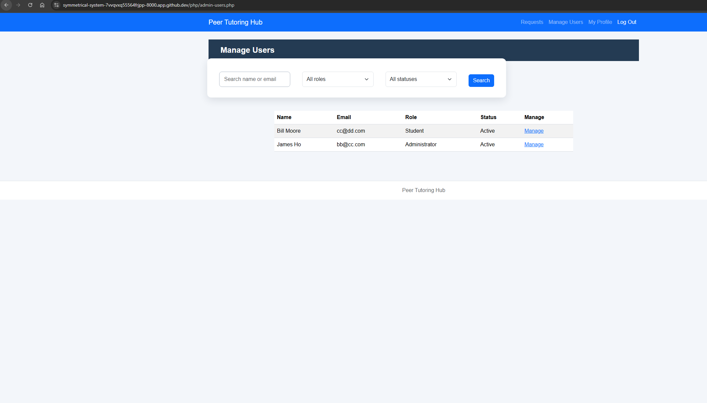

Part 1:

1. Generate code for all user management use cases UM-01 through UM-10 in the User Management Design Document.

Use the Application Builder, Test Harness Generator, and Traceability Auditor documents as implementation guidance. Follow the authentication, authorization, session management, password hashing, CSRF protection, and role based access practices in the Authentication Reading Handout.

Use lab6.zip as the existing Peer Tutoring Hub application to extend. Preserve the Lab 6 three tier architecture and update the application as needed to support user registration, login, logout, profile management, administrator access, and protected tutoring request workflows.

Return a complete Lab 7 application package with all updated and new files.

2. lab6.zip
Peer Tutoring Hub User Management Design Document
Authentication Reading Handout
AI Skills Pack

3. Lab 7 extends the lab 6 application by introducing authorization and authentication into the application. This includes adding login functionality along with the creartion of new users and updating the database accordingly. There are also session and CSRF tokens introduced to ensure proper security within the application. 

4. auth.php in the includes folder. 

Part 2:

1. sqlite3 tutoring.db < migrate-lab7.sql and sqlite3 tutoring.db < setup-database.sql
2.SQLite version 3.34.1 2021-01-20 14:10:07
Enter ".help" for usage hints.
sqlite> .tables 
3. students           tutoring_requests  users   

Part 3. 

1. @HansenAvery ➜ /workspaces/IS6465-AveryHansen/lab7/database (main ✗) $ php create-admin.php
Xdebug: [Step Debug] Could not connect to debugging client. Tried: localhost:9000 (through xdebug.client_host/xdebug.client_port) :-(
Administrator full name: James Ho
Administrator email: bb@cc.com
Administrator password (10+ characters): 
2. Administrator account created.
3. bb@cc.com
4. Administrator

Part 4: 
1. https://symmetrical-system-7vvqvxq55564frjpp-8000.app.github.dev/php/login.php

2. The application opened to the login page. 

3. It directed me to the login page. 

Part 5:

Test	                                What I Did	                    Expected Result	                                        Actual Result	                                 Pass or Fail
Register student account		       I created a user account         Student account is created		                        Student account is created                       pass
Log in as student		    I logged into my newly created account      Student can access protected student pages		        Student can access protected student pages       Pass  
View or update profile I updated my profile name to Bill Moores         Profile information is displayed or saved	            Profile information is displayed or saved		Pass
Create tutoring request  I created a tutoring request while logged in   A new request is created with status Open		        A new request is created with status Open       Pass
Edit Open request		  I edited the request and changed the date     Updated request information is displayed		        Updated request information is displayed        Pass
View my requests		 I selected requests and hit view               Student sees the student’s own requests                 Student sees the student’s own requests		    Pass
Log out		                          I hit the logout button           Session ends and login page appears		                Session ends and login page appears             Pass

Part 6:
1. Authentication is the password used to log in to the administrator account
2. Authorization is the ability to see all requests and all users. Ensuring that not every user is able to view all the requests and users. 
3.  Student access is different because you are only able to se eyour own requests and your own profile. 
4. The delete and manage users should only be limited to administrators. As well as seeing all the tutoring requests. 
5. It redirects to the login.php page and urges the user to login. 

Part 7:
Which file displays the Create Account form?
register.php

Which file receives the submitted registration form?
register.php

Which file or function creates and verifies the CSRF token?
csrdToken () in auth.php

Which service validates the registration information?
userService.php

Where is the password hashed?
password_hash() in userService.php

Which repository files insert user and student data?
userPDO.php

Which database tables receive records when a student registers?
users

Which file displays the login form?
login.php

Which file receives the submitted login credentials?
login.php

Which repository retrieves a user by email address?
findUserByEmail() in userPDO.php

Where is the submitted password verified?
authenticateUser() uses Password_verify() in userService.php

What session actions occur after successful login?
Regenerates session ID and creates a new CSRF token then redirects to profile-view.php

Why should the application regenerate the session ID after login?
It prevents session fixation where an attacker reuses a known prelogin session ID. 

How does the application determine whether the logged in user is a student or administrator?
It checks the users role found in the role column in the database to determine whether it is a student or administrator. 

Password hashing and password verification should occur in the application layer to improve securityh and keeps the application maintainable. It also allows for testibility and the presentation layer manages HTTP concerns and shouldn't be used to collect input or validation. This helps alleviate security concerns by managing these processes in the application layer. 

Part 8:

Valid time: PASS

Missing time: PASS

Altered value: PASS

Multiple valid topics: PASS

Missing topics: PASS

Altered topic: PASS

Minimum length: PASS

Maximum length: PASS

Too short: PASS

Too long: PASS

➜ /workspaces/IS6465-AveryHansen/lab7 (main ✗) $ php tests/integration-tests.php
Xdebug: [Step Debug] Could not connect to debugging client. Tried: localhost:9000 (through xdebug.client_host/xdebug.client_port) :-(
PASS UC01 create and Open
PASS Lab 4 checkbox values preserved
FAIL Duplicate email reuses student
FAIL UC02 course and status filter
PASS Invalid reason rejected
FAIL Invalid submission writes nothing
PASS Edit Open request
PASS Updated reason persisted
PASS Cancel Open request
PASS Cancelled row retained
PASS Second cancellation rejected
PASS Unrelated request unchanged
PASS FK enforced
PASS UC02 empty filter result

1. UC02 course and status filter, duplicate email reuses student, invalid submission writes nothing. 
2. Checks that submitting the same email twice creates only one student record. Checks that filtering by course IS 6465 and status Open returns exactly two test requests. Checks that a submission rejected for invalid input does not increase the tutoring-request row count.
3. The setup script preloads a Maria Lopez student, so the test sees more than one total student even if duplicate-email handling is correct. The seeded tutoring request in setup-database.sql also matches this filter, causing an extra result. The count is compared against two, but the setup script already inserted one tutoring request, so the result includes seed data.

PASS: UM-01 links Student account to students record
PASS: UM-01 rejects duplicate email
PASS: UM-01 Tutor does not receive student request record
PASS: UM-06 administrator role change persists
PASS: UM-04 updates own name and email
PASS: UM-05 rejects incorrect current password
PASS: UM-05 updates password hash
PASS: UM-07 deactivates account
PASS: UM-07 prevents last active administrator deactivation
PASS: UM-08 blocks deletion while retention policy is unresolved
PASS: UM-09 authenticates valid active account
PASS: UM-09 rejects unknown account generically
PASS: UM-07 inactive account cannot authenticate
PASS: UM-03 administrator search and filters return match
FAIL: Student workflow lists only own request
PASS: Administrator can view all requests
PASS: Tutor cannot view tutoring request workflow
PASS: UM request ownership allows own request
FAIL: UM-02 retrieves own account record by authenticated ID
Results: 19 passed, 2 failed

1. Student workflow lists only own request, and UM-02 retrieves own account record by authenticated ID. 
2. The student workflow should display only requests belonging to the authenticated student. UM-02 should retrieve the logged-in user’s account using the session/authenticated user_id.
3. Check whether the UM-02 test or test database setup reused incorrect IDs or stale session data. When testing this through the application I was only able to view the requests from the user I was logged in as. 

Part 9:
Presentation — php/register.php

Displays the registration form and generates a hidden CSRF token.
On submission, it calls verifyCsrfToken() and then registerAccount().
It redirects to the login page or displays a validation error.

Code checks out. 

Requirement             | Presentation Page | Authentication / Authorization                    | Service / Validation      | Repository / SQL          | Database              | Test
Student registers   | php/register.php | includes/auth.php Creates and verifies the CSRF token. | services/userService.php | repositories/userPDO.php | `users` and `students` | UM-01 tests account creation, password hashing, duplicate-email rejection, and student linking.
Student logs in | `php/login.php` | `includes/auth.php` | `services/userService.php` verifies the password and active status. | `repositories/userPDO.php`| `users` | UM-09 tests valid login and generic rejection of unknown/inactive accounts.
Student creates request | php/request-form.php| Requires Student login and role; verifies CSRF. | `services/requestService.php`| `repositories/requestPDO.php`| `tutoring_requests` references `students`; `users` provides account ownership. | Ownership tests pass; the UI displays only the logged-in student's requests.
User logs out | `php/logout.php` | Verifies CSRF, clears the session, expires the cookie, and destroys the session. | None required. | No database write. | No table changes. | Protected pages redirect to login after logout.

Suggested test: Inactive account cannot log in
1. This is tested already in UM-09 authenticates valid active account
2. Set an account to inactive and attempt to log in with it. 
3. I would say it is an appropriate test and would be valuable for security puposes. 

Part 10:
1. The LEFT JOIN returns every row from users even if there is no matching row in students. 
2. The users table connects to students through a foreign key referencing the user id. This is a one to one link. 
3. It stores account information seperately because not every user is going to be a student, like the administrator account created. 
4. An administrator account wont have a matching row in the students table because it is unlikely they are a student as well. 