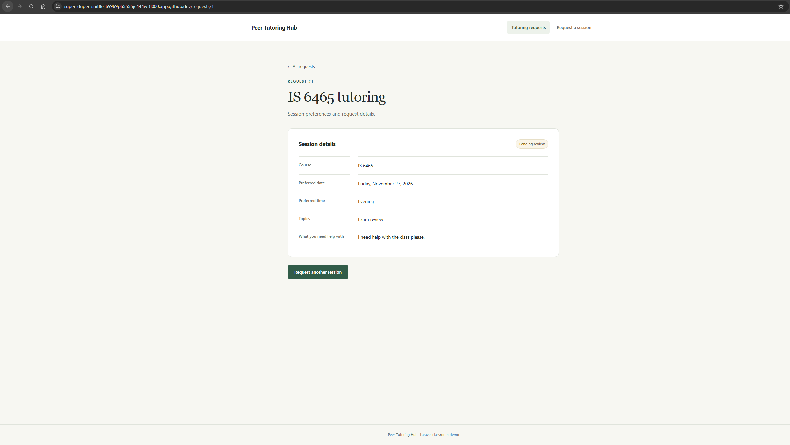

What business purpose does the Peer Tutoring Hub application support?

The peer tutoring hub allows for students to request tutoring sessions. 

Identify one route used by the application. What URL or user action causes that route to run?

Route::get(
    '/requests/create',
    [TutoringRequestController::class, 'create']
)->name('requests.create');

When you request a session this route is used by the application. 

Identify the controller involved in one application workflow. What is the controller responsible for doing?

    public function create()
    {
        return view('requests.create', [
            'courses' => self::COURSES,
            'topics' => self::TOPICS,
            'times' => self::TIMES,
        ]);
    }

This controller is responsible for handling the request and validating the input. 

Identify one model used by the application. What business data does it represent?

tutoringrequest.php represents the data structure of the application. In this case it saves the data for these variables
        'course',
        'reason',
        'topics',
        'preferred_date',
        'preferred_time',

Identify one view or Blade template. What does the user see or do on that page?

app.blade.php This displays the actual application to the user. The user is view the application and see the tutoring requests and request a session hyperlinks. 

Explain how a request moves through the MVC pattern for one workflow in the application. Your explanation should identify:

When you initially request a session you are routed by web.php which directs you to the controller. The controller then validates the input and provides the structure of the function. Then tutoringrequest.php the model in this case will represent the data structure allowing the application to save the data properly. Then the application will update the view pages to show you the new session. 

Compare Laravel’s MVC organization with the architecture used in your course project. Identify one benefit Laravel provides and one reason we are not requiring you to convert your project to Laravel at this point.

I think Laravel allows you to handle data easier and the format of the saved data is easier to follow.
A major reason we are not being required to convert our project to Laravel at this moment is because it follows a completely different structure and requires you to learn a new framework for coding. This can be very time consuming and also wouldn't build our basic understanding of web application development. 

A screenshot of the running Laravel application in Codespaces or in the browser.

A screenshot or short description showing one file from each MVC area:

route - web.php forwards the POST or GET request to the controller. 

controller - tutoringrequestcontroller.php defines the functions used for each request. Acts as the middleman and handles request data and input validation. 

model - tutoringrequest.php represents the data structure of the application. In this case it saves the data for these variables
        'course',
        'reason',
        'topics',
        'preferred_date',
        'preferred_time',

view - app.blade.php This displays the actual application to the user. 

A brief reflection of about one paragraph: What did Laravel make easier to understand or organize? What felt new or potentially confusing?

I think the overall structure of the data and how it is formatted is a little bit easier to follow. When looking at the models used in the Laravel application you are able to clearly see how the variables are used and saved to the database. Also the controllers having all your functions and arrays in one place make it easy to follow. I think Laravel as a whole felt new, it didn't even feel like it was a PHP application it felt like it was a whole new language. I think the view pages in Laravel can be more difficult to understand and harder to trace the work flow. ALso the creation of the new view pages aren't easy to discern what each one does as the naming convention isn't as traceable. An example of this "0c5c42dbe9a79eccf7a85c695a34fc2b.php". 